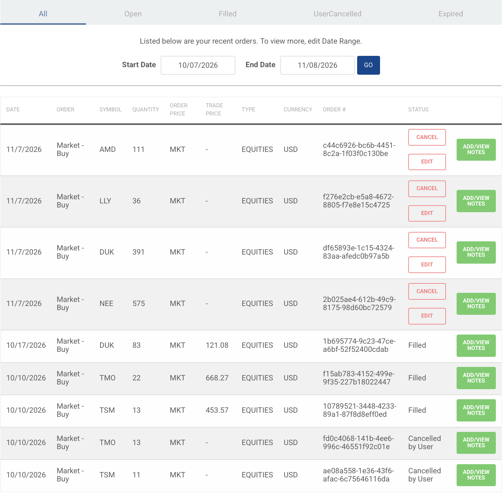
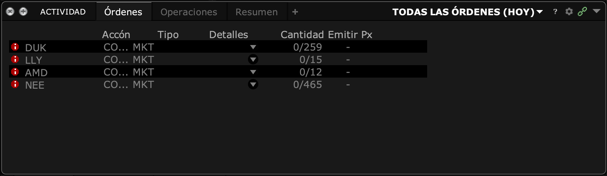

##  OBJETIVO DEL PROYECTO
##  Aplicar a las acciones de mi portafolio de How the Market Works (HTMW) los modelos vistos en el curso, y usar sus pronósticos para definir dos estrategias de compra: una para HTMW y otra para Interactive Brokers (IB).
##  Modelos:
##  1) Regresión lineal simple (datos intradía de 30 minutos, Refinitiv).
##  2) Regresión lineal múltiple (datos intradía de 30 minutos, Refinitiv).
##  3) Datos de panel (reportes trimestrales, Refinitiv).
##  4) Series de tiempo con pronóstico (ARIMA, datos intradía de 30 minutos).
##  5) GARCH (pronóstico de volatilidad).
##  6) Estrategias de compra en HTMW y en IB (vía API con IBrokers).

##  MI PORTAFOLIO EN HTMW (al 7 de noviembre de 2026)
##  Valor del portafolio: $993,794 | Efectivo: $817,013
##  | Sector           | Acciones / fondo                         |
##  | Semiconductores  | NVDA, AVGO, AMD, MU, TSM + fondo FSELX    |
##  | Salud            | LLY, UNH, ISRG, VRTX, TMO + fondo FSPHX   |
##  | Utilities        | DUK, NEE, CEG, VST + fondo FSUTX          |
##  Trabajo con las 14 acciones (el mínimo pedido es 10). Los fondos mutuos no cotizan durante el día (solo tienen un precio al cierre), por eso en los modelos intradía uso como referencia de cada sector su ETF: SMH (semiconductores), XLV (salud) y XLU (utilities).

##  DATOS
##  --precios_30m.csv: precios de cierre cada 30 minutos de las 14 acciones y los 3 ETFs, del 8 de octubre al 6 de noviembre de 2026 (Refinitiv Workspace, Price History, intervalo 30 minutos). Me quedo solo con el horario normal de mercado (9:30 a 16:00 hora de Nueva York): 22 sesiones x 13 barras = 286 observaciones por acción.
##  --reportes_trimestrales.csv: reportes trimestrales de las 14 empresas del 1T 2020 al 3T 2026 (Refinitiv Workspace, Financial Summary, estandarizados, en millones de USD).


##  LIBRERIAS RELEVANTES
```{r, message=FALSE, warning=FALSE}
library(lmtest)
library(car)
library(sandwich)
library(plm)
library(forecast)
library(tseries)
library(fGarch)
library(ggplot2)
```


##  LECTURA DE DATOS
```{r}
precios <- read.csv("precios_30m.csv", check.names = FALSE)
head(precios)
dim(precios)

## Rendimientos logarítmicos cada 30 minutos, en porcentaje
rend <- as.data.frame(lapply(precios[, -1], function(x) diff(log(x)) * 100))
summary(rend[, c("NVDA", "LLY", "DUK", "SMH", "XLV", "XLU")])

acciones <- c("NVDA", "AVGO", "AMD", "MU", "TSM",
              "LLY", "UNH", "ISRG", "VRTX", "TMO",
              "DUK", "NEE", "CEG", "VST")
etf_sector <- c(rep("SMH", 5), rep("XLV", 5), rep("XLU", 4))
```
##  Tengo 285 rendimientos de 30 minutos por acción. Trabajo con rendimientos y no con precios porque, como vi en la Actividad 2.1, los precios se comportan como caminata aleatoria (no estacionarios) y los rendimientos como ruido blanco (estacionarios).


##  1) REGRESIÓN LINEAL SIMPLE: CADA ACCIÓN CONTRA SU ETF DEL SECTOR
##  Modelo: rend_accion = b0 + b1 * rend_ETF + u
##  b1 es la "beta" de la acción contra su sector: cuánto se mueve la acción cuando el sector se mueve 1%.

##  Ejemplo completo con NVDA contra SMH
```{r}
simple_nvda <- lm(NVDA ~ SMH, data = rend)
summary(simple_nvda)
```
##  Beta = 0.77: cuando SMH sube 1% en 30 minutos, NVDA sube en promedio 0.77%. Es significativa (p < 0.001) y la R2 de 84% indica que el sector explica la mayor parte del movimiento de NVDA. El intercepto no es significativo: NVDA no tuvo un rendimiento extra a su sector en este periodo.

##  Las 14 regresiones simples
```{r}
tabla_simple <- data.frame()
for (i in seq_along(acciones)) {
  m <- lm(rend[[acciones[i]]] ~ rend[[etf_sector[i]]])
  s <- summary(m)
  tabla_simple <- rbind(tabla_simple, data.frame(
    accion = acciones[i],
    etf = etf_sector[i],
    beta = round(coef(m)[2], 3),
    p_beta = signif(s$coefficients[2, 4], 3),
    R2 = round(s$r.squared, 3)))
}
rownames(tabla_simple) <- NULL
tabla_simple
```
##  --Semiconductores: todas tienen R2 de 81% a 90%, se mueven muy de cerca con SMH. AMD (1.65) y MU (1.39) tienen beta mayor a 1: son más agresivas que el sector. NVDA (0.77), AVGO (0.87) y TSM (0.92) son un poco más defensivas.
##  --Salud: LLY tiene beta de 1.71 y R2 de 74%, es la acción que más mueve a XLV. ISRG (R2 15%) y TMO (R2 18%) se mueven mucho más por factores propios que por el sector.
##  --Utilities: DUK (beta 1.07, R2 61%) y NEE (R2 36%) siguen al sector. CEG y VST casi no se explican con XLU (R2 de 3% y 2%): se comportan más como acciones de tecnología/IA por su exposición a los data centers, no como utilities tradicionales.
##  Todas las betas son significativas al 5%.


##  2) REGRESIÓN LINEAL MÚLTIPLE: CADA ETF CONTRA SUS ACCIONES
##  Es la misma idea de las Tareas 3 y 5 (cada fondo contra sus 5 acciones), pero con datos de 30 minutos y usando el ETF del sector.

##  Modelo 1: SMH ~ NVDA + AVGO + AMD + MU + TSM
```{r}
mult_smh <- lm(SMH ~ NVDA + AVGO + AMD + MU + TSM, data = rend)
summary(mult_smh)
vif(mult_smh)
bptest(mult_smh)
dwtest(mult_smh)
coeftest(mult_smh, vcov = NeweyWest(mult_smh))
```
##  Las 5 acciones son significativas y en conjunto explican el 96.6% de SMH. AVGO (0.24) y NVDA (0.23) son las de mayor peso, lo que coincide con que son las posiciones más grandes del ETF.
##  VIF: AMD (9.0) y TSM (11.1) están cerca o arriba de 10, hay multicolinealidad alta porque las 5 acciones se mueven juntas. Los coeficientes individuales deben leerse con cuidado, aunque el modelo en conjunto es muy bueno.
##  Breusch-Pagan (p < 0.001): hay heterocedasticidad. Durbin-Watson (p = 0.21): no hay autocorrelación.
##  Por la heterocedasticidad uso errores robustos (Newey-West), y todas las acciones siguen siendo significativas.

##  Modelo 2: XLV ~ LLY + UNH + ISRG + VRTX + TMO
```{r}
mult_xlv <- lm(XLV ~ LLY + UNH + ISRG + VRTX + TMO, data = rend)
summary(mult_xlv)
vif(mult_xlv)
bptest(mult_xlv)
dwtest(mult_xlv)
coeftest(mult_xlv, vcov = NeweyWest(mult_xlv))
```
##  Las 5 acciones son significativas y explican el 91.8% de XLV. LLY tiene el mayor peso (0.28), seguida de VRTX (0.17).
##  VIF menores a 2: no hay multicolinealidad, a diferencia de semiconductores, porque las acciones de salud se mueven de forma más independiente entre sí.
##  Hay heterocedasticidad (Breusch-Pagan p < 0.001) y no hay autocorrelación (Durbin-Watson p = 0.97). Con errores robustos las conclusiones se mantienen.

##  Modelo 3: XLU ~ DUK + NEE + CEG + VST
```{r}
mult_xlu <- lm(XLU ~ DUK + NEE + CEG + VST, data = rend)
summary(mult_xlu)
vif(mult_xlu)
bptest(mult_xlu)
dwtest(mult_xlu)
coeftest(mult_xlu, vcov = NeweyWest(mult_xlu))
```
##  Las 4 acciones son significativas y explican el 91.3% de XLU. DUK domina con un coeficiente de 0.68; NEE, CEG y VST tienen pesos de 0.08 a 0.10.
##  VIF menores a 5: no hay multicolinealidad grave. Hay heterocedasticidad fuerte (Breusch-Pagan p < 0.001) y no hay autocorrelación (Durbin-Watson p = 0.99). Con errores robustos DUK, CEG y VST siguen siendo significativas, pero NEE deja de serlo (p = 0.15): su relación con XLU no es tan sólida una vez que corrijo la heterocedasticidad.
##  Conclusión de las regresiones: mis acciones explican más del 90% del movimiento de su sector, así que mi portafolio está bien representado por los tres sectores.


##  3) DATOS DE PANEL: REPORTES TRIMESTRALES DE LAS 14 EMPRESAS
##  Continúo la pregunta de la Tarea 6, ahora con todo mi portafolio: ¿la inversión (capex) se está financiando con deuda?
##  Modelo: deuda = b0 + b1*utilidad + b2*capex + b3*cfo + b4*efectivo + u
##  En lugar del EBITDA uso la utilidad neta, porque Refinitiv no reporta EBITDA para UNH (es una aseguradora) y así puedo incluir a las 14 empresas.
##  Variables en miles de millones de USD. Panel: 14 empresas, 1T 2020 a 3T 2026.
```{r}
reportes <- read.csv("reportes_trimestrales.csv")

## ISRG no tiene deuda y VRTX no tuvo deuda en algunos trimestres: Refinitiv deja el dato vacío, así que lo pongo en cero
reportes$deuda[is.na(reportes$deuda) & reportes$empresa %in% c("ISRG", "VRTX")] <- 0

for (v in c("ingresos", "ebitda", "utilidad", "deuda", "capex", "cfo", "efectivo", "activos", "capital")) {
  reportes[[v]] <- reportes[[v]] / 1000
}
table(reportes$empresa)
aggregate(cbind(deuda, utilidad, capex, cfo) ~ sector, data = reportes, FUN = mean)

panel <- pdata.frame(reportes, index = c("empresa", "trimestre"))
```
##  El panel no está balanceado (CEG solo existe desde 2021), pero plm lo acepta. Utilities es el sector con más deuda promedio y semiconductores el de mayor utilidad.

##  MCO y pooled
```{r}
panel_po <- plm(deuda ~ utilidad + capex + cfo + efectivo, data = panel, model = "pooling")
summary(panel_po)
```
##  El pooled trata a las 14 empresas como si fueran una sola. La R2 es de apenas 6% y la utilidad sale con signo negativo, lo cual no tiene sentido económico: el modelo mezcla empresas muy distintas (utilities con mucha deuda y poca utilidad, y semiconductores con lo contrario).

##  Efectos fijos
```{r}
panel_fe <- plm(deuda ~ utilidad + capex + cfo + efectivo, data = panel, model = "within")
summary(panel_fe)
fixef(panel_fe)
```
##  Controlando por empresa, solo el capex es significativo (2.40, p < 0.001): cuando una empresa aumenta su capex trimestral en mil millones, su deuda es 2.4 mil millones mayor.
##  Los interceptos confirman las diferencias entre empresas: DUK (69.5), NEE (68.1), UNH (57.5) y AVGO (50.4) tienen una deuda "base" muy alta, mientras que ISRG y VRTX (cerca de 0) prácticamente no tienen deuda.

##  Prueba F: ¿pooled o efectos fijos?
```{r}
pFtest(panel_fe, panel_po)
```
##  F = 227.2 con p < 0.001: rechazo H0, las diferencias entre empresas son significativas y el pooled no es adecuado.

##  Efectos aleatorios
```{r}
panel_re <- plm(deuda ~ utilidad + capex + cfo + efectivo, data = panel, model = "random")
summary(panel_re)
```
##  Los coeficientes son casi idénticos a los de efectos fijos (capex 2.40, p < 0.001).

##  Prueba de Hausman: ¿efectos fijos o aleatorios?
```{r}
phtest(panel_fe, panel_re)
```
##  Chi2 = 0.24 con p = 0.99: no rechazo H0, efectos aleatorios es consistente y más eficiente, así que me quedo con él.

##  Prueba de Wooldridge (autocorrelación) y de Pesaran (dependencia transversal)
```{r}
pwartest(panel_fe)
pcdtest(panel_fe, test = "cd")
```
##  Wooldridge (p < 0.001): hay autocorrelación, lógico porque la deuda se arrastra de un trimestre a otro.
##  Pesaran (z = 10.4, p < 0.001): hay dependencia entre empresas. A diferencia de la Tarea 6, ahora sí aparece, porque con 14 empresas de tres sectores se nota que todas reaccionan a lo mismo (tasas de interés, ciclo de inversión en IA).

##  Modelo final: efectos aleatorios con errores Driscoll-Kraay
##  Como hay autocorrelación Y dependencia entre empresas, uso errores Driscoll-Kraay, que corrigen los dos problemas a la vez.
```{r}
coeftest(panel_re, vcov = vcovSCC(panel_re))
```
##  Con los errores corregidos, el capex sigue siendo significativo (p < 0.001). La utilidad, el flujo de operación y la caja no lo son.
##  Conclusión del panel: igual que en la Tarea 6 con las utilities, en todo mi portafolio el capex es la variable que se asocia con más deuda. Desde el punto de vista de crédito, las empresas que más invierten (semiconductores por capacidad de producción y utilities por la demanda de los data centers) son las que más se están endeudando.


##  4) SERIES DE TIEMPO: PRONÓSTICO CON ARIMA
##  Siguiendo el material de apoyo (Introduction to time series analysis), primero reviso los componentes de la serie y su estacionariedad, y después estimo un ARIMA para pronosticar.

##  Ejemplo completo con NVDA
```{r}
nvda <- ts(log(precios$NVDA), frequency = 13)  # 13 barras de 30 minutos = 1 día de mercado
plot(precios$NVDA, type = "l", main = "NVDA cada 30 minutos (8-oct a 6-nov-2026)", xlab = "Barra de 30 minutos", ylab = "USD")

## Descomposición en tendencia, estacionalidad (patrón dentro del día) y residuos
descomp <- stl(nvda, s.window = "periodic")
plot(descomp, main = "Descomposición STL del log-precio de NVDA")
```
##  La tendencia domina la serie: NVDA bajó de 234 a 187 USD en el mes. El componente estacional (el patrón que se repite cada día) es muy pequeño, de máximo 0.2%, así que no hay un patrón intradía útil para pronosticar. Los residuos se ven como ruido.

```{r}
## Prueba de raíz unitaria (Dickey-Fuller aumentada): H0 = la serie NO es estacionaria
adf.test(log(precios$NVDA))
adf.test(rend$NVDA)

## Autocorrelación de los rendimientos (hasta 5 rezagos)
acf(rend$NVDA, lag.max = 5, plot = FALSE)
```
##  ADF del log-precio: p = 0.53, no rechazo H0, el precio NO es estacionario (caminata aleatoria). ADF de los rendimientos: p = 0.01, son estacionarios.
##  Las autocorrelaciones de los rendimientos en los rezagos 1 a 5 son muy pequeñas (todas menores a 0.06): los rendimientos de NVDA se parecen a un ruido blanco.

```{r}
## ARIMA: limito el modelo a máximo 5 rezagos (p y q hasta 5), como indicó el profesor
arima_nvda <- auto.arima(log(precios$NVDA), max.p = 5, max.q = 5, seasonal = FALSE)
arima_nvda
Box.test(residuals(arima_nvda), lag = 10, type = "Ljung-Box", fitdf = 1)

## Pronóstico de t+1 a t+5 (las siguientes 5 barras de 30 minutos)
pron_nvda <- forecast(arima_nvda, h = 5)
exp(pron_nvda$mean)
plot(pron_nvda, include = 60, main = "Pronóstico ARIMA del log-precio de NVDA (t+1 a t+5)")
```
##  El modelo elegido es un ARIMA(1,1,0) con deriva: el precio se diferencia una vez (d = 1) porque no es estacionario. El coeficiente AR(1) es muy pequeño (-0.04) y la deriva es negativa, porque en el último mes NVDA bajó en promedio 0.08% cada 30 minutos.
##  Ljung-Box (p = 0.77): los residuos son ruido blanco, el modelo captura lo que se puede capturar.
##  Pronóstico: de 186.68 a 185.99 USD en 5 barras (-0.37%). Básicamente el modelo proyecta que continúe la tendencia del mes; las bandas de confianza son anchas, lo cual es normal en un precio que se comporta como caminata aleatoria.

##  Pronóstico para las 14 acciones
```{r, warning=FALSE}
tabla_arima <- data.frame()
for (a in acciones) {
  fit <- auto.arima(log(precios[[a]]), max.p = 5, max.q = 5, seasonal = FALSE)
  fc <- exp(forecast(fit, h = 5)$mean)
  ultimo <- tail(precios[[a]], 1)
  tabla_arima <- rbind(tabla_arima, data.frame(
    accion = a,
    adf_p_precio = round(adf.test(log(precios[[a]]))$p.value, 3),
    adf_p_rend = round(adf.test(rend[[a]])$p.value, 3),
    modelo = paste0("ARIMA(", paste(arimaorder(fit), collapse = ","), ")"),
    ultimo_precio = round(ultimo, 2),
    pron_t1 = round(fc[1], 2),
    pron_t3 = round(fc[3], 2),
    pron_t5 = round(fc[5], 2),
    rend_esperado_pct = round((fc[5] / ultimo - 1) * 100, 3)))
}
tabla_arima
```
##  --Estacionariedad: en las 14 acciones el ADF de los rendimientos da p = 0.01 (estacionarios). En los precios, 13 de 14 tienen p > 0.05 (no estacionarios); solo DUK (p = 0.04) sale en el límite. Por eso todos los modelos usan d = 1.
##  --Pronósticos: con rendimiento esperado positivo a t+5 están DUK (+0.22%), NEE (+0.21%), LLY (+0.05%) y AMD (+0.02%). UNH e ISRG tienen pronóstico igual a su último precio (rendimiento esperado de 0%): ISRG es una caminata aleatoria pura (ARIMA(0,1,0)) y en UNH el componente AR es prácticamente cero. Los semiconductores (NVDA, AVGO, MU, TSM), CEG y VST tienen pronóstico negativo, reflejando la caída de las acciones ligadas a IA en las últimas semanas.
##  Los rendimientos esperados son pequeños (menos de 1%), lo cual es consistente con lo visto en la Actividad 2.1: en una caminata aleatoria el mejor pronóstico es cercano al último precio.


##  5) GARCH(1,1): PRONÓSTICO DE VOLATILIDAD (PUNTOS EXTRA)
##  Modelo: varianza_t = w + a * u²_(t-1) + b * varianza_(t-1)
##  El GARCH no pronostica el precio sino el riesgo: qué tan grande puede ser el movimiento en las siguientes barras.
```{r}
garch_nvda <- garchFit(~ garch(1, 1), data = rend$NVDA, trace = FALSE)
summary(garch_nvda)
predict(garch_nvda, n.ahead = 5)
```
##  Para NVDA, alpha + beta es cercano a 1: la volatilidad es muy persistente, un día de mucho movimiento tiende a seguir con más movimiento. La desviación estándar pronosticada es de 1.3% cada 30 minutos.

```{r, warning=FALSE}
tabla_garch <- data.frame()
for (a in acciones) {
  g <- garchFit(~ garch(1, 1), data = rend[[a]], trace = FALSE)
  vol <- predict(g, n.ahead = 5)$standardDeviation
  tabla_garch <- rbind(tabla_garch, data.frame(
    accion = a,
    alpha1 = round(coef(g)["alpha1"], 3),
    beta1 = round(coef(g)["beta1"], 3),
    persistencia = round(coef(g)["alpha1"] + coef(g)["beta1"], 3),
    vol_pronosticada_pct = round(mean(vol), 3)))
}
rownames(tabla_garch) <- NULL
tabla_garch
```
##  --Las más volátiles son AMD (2.9% cada 30 minutos), MU (1.9%), VST (1.4%), NVDA y AVGO (1.3%).
##  --Las menos volátiles son NEE (0.4%), UNH, TMO y DUK (0.5%).
##  --La mayoría tiene persistencia cercana a 1: los choques de volatilidad tardan en disiparse. VRTX (0.62), LLY (0.77) y NEE (0.30) tienen menor persistencia.
##  --En las 5 acciones de salud alpha1 es 0: su volatilidad no reacciona a los choques recientes, se mantiene prácticamente constante en el periodo.


##  6) ESTRATEGIAS DE COMPRA
##  Junto el pronóstico de rendimiento (ARIMA) con el de riesgo (GARCH).
##  Regla: solo compro las acciones con rendimiento esperado POSITIVO. No vendo ninguna posición actual.
```{r}
senales <- merge(tabla_arima[, c("accion", "ultimo_precio", "rend_esperado_pct")],
                 tabla_garch[, c("accion", "vol_pronosticada_pct")], by = "accion")
senales$rend_por_riesgo <- round(senales$rend_esperado_pct / senales$vol_pronosticada_pct, 3)
senales <- senales[order(-senales$rend_por_riesgo), ]
senales
compras <- senales[senales$rend_esperado_pct > 0, ]
compras
```
##  Las acciones con señal de compra son DUK, NEE, LLY y AMD. Ordenadas por rendimiento por unidad de riesgo, NEE y DUK son las mejores: rendimiento esperado positivo con volatilidad baja.

##  ESTRATEGIA 1: HOW THE MARKET WORKS (pesos iguales)
##  Invierto $50,000 de mi efectivo en cada acción con señal de compra (orden de mercado).
```{r}
monto_htmw <- 50000
orden_htmw <- data.frame(
  accion = compras$accion,
  precio = compras$ultimo_precio,
  acciones_a_comprar = floor(monto_htmw / compras$ultimo_precio))
orden_htmw$monto <- round(orden_htmw$acciones_a_comprar * orden_htmw$precio, 2)
orden_htmw
sum(orden_htmw$monto)
```
##  Total a invertir: cerca de $200,000 de mis $817,013 en efectivo. Las órdenes se colocan en HTMW como órdenes de mercado y se ejecutan en la siguiente apertura.

##  Órdenes colocadas en HTMW el 7 de noviembre de 2026 (NEE 575, DUK 391, LLY 36 y AMD 111 acciones, órdenes de mercado pendientes de ejecución en la apertura del lunes):




##  ESTRATEGIA 2: INTERACTIVE BROKERS (pesos por inverso de la volatilidad)
##  En IB uso una regla distinta: reparto un presupuesto de $100,000 dando más peso a las acciones menos volátiles según el GARCH (peso = (1/volatilidad) / suma de (1/volatilidad)). Así cada acción aporta un riesgo parecido al portafolio.
##  Las órdenes se envían de forma automática desde R a TWS (cuenta demo) con la API de IBrokers, como en la clase del 26 de octubre.
```{r}
presupuesto_ib <- 100000
peso <- (1 / compras$vol_pronosticada_pct) / sum(1 / compras$vol_pronosticada_pct)
orden_ib <- data.frame(
  accion = compras$accion,
  precio = compras$ultimo_precio,
  peso = round(peso, 3),
  acciones_a_comprar = floor(presupuesto_ib * peso / compras$ultimo_precio))
orden_ib$monto <- round(orden_ib$acciones_a_comprar * orden_ib$precio, 2)
orden_ib
sum(orden_ib$monto)
```
##  NEE recibe el mayor peso por ser la menos volátil, y AMD el menor por ser la más volátil.

##  Envío de las órdenes a IB
##  Para no mandar órdenes repetidas cada vez que hago Knit, el envío solo se ejecuta si cambio ejecutar_ib a TRUE. Las órdenes las envié una sola vez desde RStudio con TWS abierto.
```{r}
ejecutar_ib <- FALSE

if (ejecutar_ib) {
  library(IBrokers)
  tws <- twsConnect(clientId = 5, port = 7497)
  print(isConnected(tws))
  for (i in seq_len(nrow(orden_ib))) {
    contrato <- twsEquity(orden_ib$accion[i], exch = "SMART", currency = "USD")
    id_orden <- as.numeric(reqIds(tws))
    mi_orden <- twsOrder(id_orden, orderType = "MKT", action = "BUY",
                         totalQuantity = as.character(orden_ib$acciones_a_comprar[i]),
                         transmit = TRUE)
    placeOrder(tws, contrato, mi_orden)
    cat("Orden enviada:", orden_ib$accion[i], orden_ib$acciones_a_comprar[i], "acciones\n")
    Sys.sleep(1)
  }
  twsDisconnect(tws)
}
```


##  Órdenes recibidas en TWS (cuenta demo) después de enviarlas desde R: NEE 465, DUK 259, LLY 15 y AMD 12 acciones, compras a mercado pendientes de ejecución porque el mercado está cerrado.




##  CONCLUSIÓN
##  1) Regresiones: mis acciones explican más del 90% del movimiento de su sector. Las betas muestran que AMD, MU y LLY son las más agresivas, y que CEG y VST ya no se comportan como utilities tradicionales.
##  2) Panel: en las 14 empresas el capex es la variable asociada con más deuda (efectos aleatorios con errores Driscoll-Kraay), lo que confirma lo encontrado en la Tarea 6.
##  3) Series de tiempo: los precios son no estacionarios y los rendimientos sí son estacionarios; los ARIMA pronostican movimientos pequeños, con señal positiva para DUK, NEE, LLY y AMD, y negativa para los semiconductores.
##  4) GARCH: la volatilidad es persistente; AMD y MU son las más riesgosas y NEE y DUK las más estables.
##  5) Estrategias: en HTMW compro $50,000 de cada acción con señal positiva (pesos iguales) y en IB reparto $100,000 por inverso de la volatilidad. En ambos casos solo compro, sin vender posiciones.
##  6) Limitación: el periodo es corto (un mes de datos de 30 minutos) y los pronósticos de un ARIMA sobre una serie que se parece a una caminata aleatoria tienen poco poder predictivo. Las estrategias deben verse como un ejercicio de aplicación de los modelos, no como una garantía de rendimiento.
