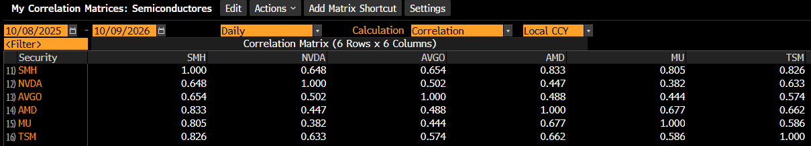
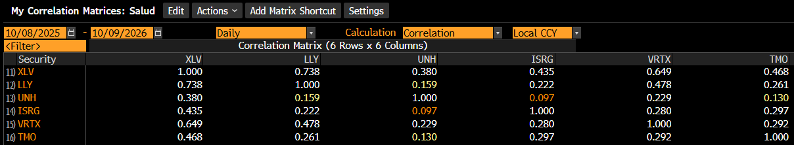
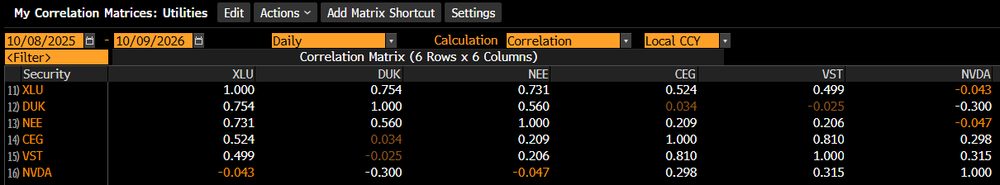
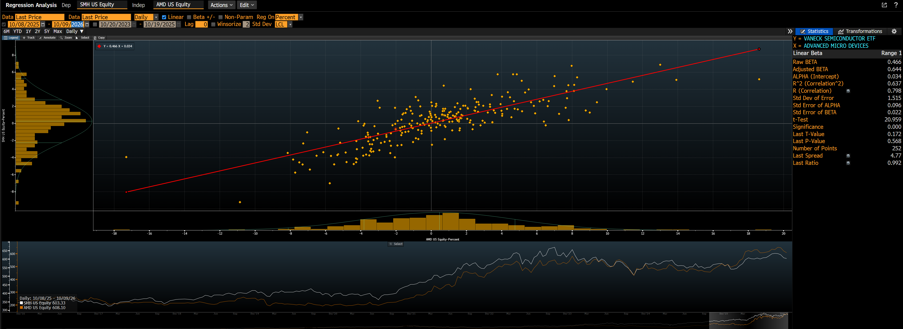
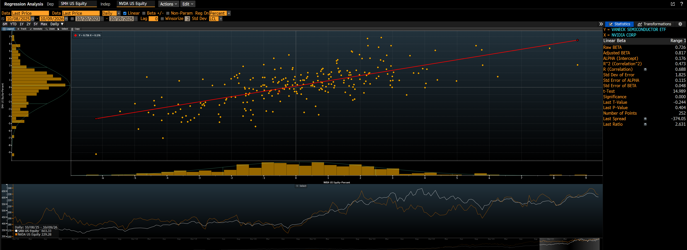
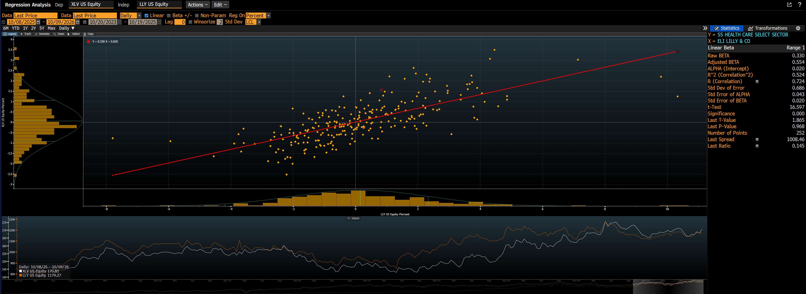
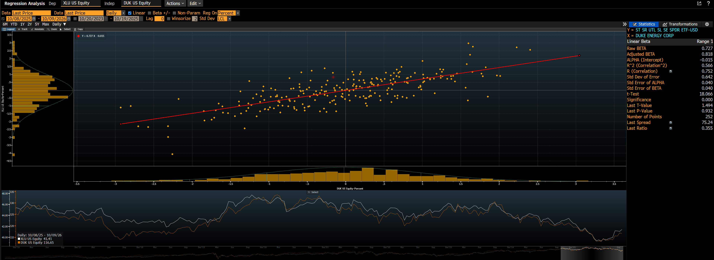
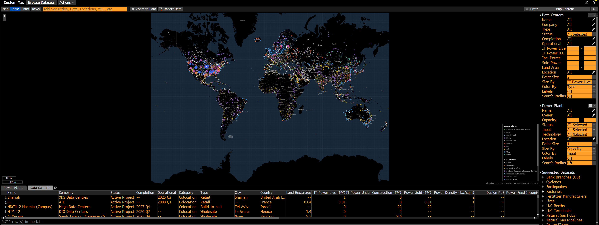

##  OBJETIVO DE LA TAREA
##  1) Correr regresiones lineales simples en Bloomberg y en R con los mismos datos y fechas, y cotejar que den los mismos resultados.
##  2) Cotejar las matrices de correlación de Bloomberg contra las calculadas en R.
##  3) Cotejar los resultados con datos por minuto de Bloomberg contra los de LSEG (Refinitiv) para los mismos minutos.
##  Variables dependientes: los ETF sectoriales SMH (semiconductores), XLV (salud) y XLU (utilities). Se usan los ETF y no los mutual funds porque los fondos no tienen precios por minuto.
##  Variables independientes: las acciones de cada sector de la Tarea 3. Para las regresiones simples se eligió, en cada sector, la acción con mayor correlación con su ETF según la matriz de Bloomberg (AMD, LLY y DUK), más SMH contra NVDA como contraste.


##  LIBRERIAS RELEVANTES
```{r}
library(MASS)
library(ISLR)
library(quantmod)
library(car)
library(lmtest)
library(readxl)
```


##  PRIMERA PARTE: DATOS DIARIOS (MISMO PERIODO QUE BLOOMBERG: 08/10/2025 - 09/10/2026)

```{r}

##  Rendimientos diarios con el precio de cierre (Bloomberg calcula la correlación y la regresión con el cambio porcentual del precio de cierre)
rend_d <- function(ticker) {
  p <- getSymbols(ticker, from = "2025-10-08", to = "2026-10-10", auto.assign = FALSE)
  r <- dailyReturn(Cl(p))
  colnames(r) <- ticker
  r
}

tickers_d <- c("SMH", "NVDA", "AVGO", "AMD", "MU", "TSM",
               "XLV", "LLY", "UNH", "ISRG", "VRTX", "TMO",
               "XLU", "DUK", "NEE", "CEG", "VST")

diario <- as.data.frame(coredata(na.omit(do.call(merge, lapply(tickers_d, rend_d)))))
diario <- diario[-1, ]   # se quita el primer día (8 de octubre de 2025), que no tiene rendimiento contra un día anterior
dim(diario)

```


##  MATRICES DE CORRELACIÓN (R vs BLOOMBERG)

##  Matrices de correlación de Bloomberg (función CORR, diario, 08/10/2025 - 09/10/2026):







```{r}

round(cor(diario[, c("SMH", "NVDA", "AVGO", "AMD", "MU", "TSM")]), 3)

##  SEMICONDUCTORES (Bloomberg): SMH se correlaciona más con AMD (0.833), TSM (0.826) y MU (0.805), y menos con NVDA (0.648) y AVGO (0.654).
##  Entre las acciones, las correlaciones van de 0.38 (NVDA-MU) a 0.68 (AMD-MU): se mueven juntas, pero no al grado de causar multicolinealidad grave.
##  COTEJO CON R: SMH-AMD 0.798 (Bloomberg 0.833), SMH-TSM 0.839 (0.826), SMH-MU 0.799 (0.805), SMH-NVDA 0.688 (0.648), SMH-AVGO 0.700 (0.654).
##  El orden general se parece (TSM, MU y AMD arriba; NVDA y AVGO abajo), pero hay diferencias de hasta 0.06, mayores que en los otros dos sectores. Ver la nota al final de esta sección.

round(cor(diario[, c("XLV", "LLY", "UNH", "ISRG", "VRTX", "TMO")]), 3)

##  SALUD (Bloomberg): XLV se correlaciona más con LLY (0.738) y VRTX (0.649); UNH (0.380) e ISRG (0.435) son las menos relacionadas.
##  Entre las acciones las correlaciones son bajas (0.10 a 0.48): cada una representa un negocio distinto dentro del sector.
##  COTEJO CON R: XLV-LLY 0.724 (Bloomberg 0.738), XLV-VRTX 0.639 (0.649), XLV-TMO 0.471 (0.468), XLV-ISRG 0.438 (0.435), XLV-UNH 0.373 (0.380).
##  Las diferencias son de 0.015 o menos en todos los pares: R y Bloomberg coinciden.

round(cor(diario[, c("XLU", "DUK", "NEE", "CEG", "VST", "NVDA")]), 3)

##  UTILITIES (Bloomberg): XLU se correlaciona más con DUK (0.754) y NEE (0.731), y menos con CEG (0.524) y VST (0.499).
##  Se mantienen los dos bloques de tareas anteriores: utilities clásicas (DUK-NEE 0.560) y generadoras ligadas a IA (CEG-VST 0.810).
##  NVDA tiene correlación casi nula con XLU (-0.043) y NEGATIVA con DUK (-0.300): cuando NVDA sube, DUK tiende a bajar, y viceversa.
##  COTEJO CON R: XLU-DUK 0.752 (Bloomberg 0.754), XLU-NEE 0.734 (0.731), XLU-CEG 0.533 (0.524), XLU-VST 0.507 (0.499), XLU-NVDA -0.042 (-0.043), DUK-NVDA -0.313 (-0.300).
##  Las diferencias son de 0.01 o menos: R y Bloomberg coinciden.

##  NOTA SOBRE LAS DIFERENCIAS
##  En salud y utilities R reproduce la matriz CORR de Bloomberg casi exacto. En semiconductores hay diferencias de hasta 0.06.
##  El periodo y los datos son los mismos: la función HRA de Bloomberg, con las mismas fechas, da para SMH-AMD una correlación de 0.798 y para SMH-NVDA de 0.688, exactamente iguales a R (ver la sección de regresiones).
##  Por lo tanto, la diferencia viene de la forma en que la matriz CORR hace el cálculo (configuración de la función), no de los datos. El cotejo correcto contra R es el de HRA, que coincide al 100%.

```


##  REGRESIONES LINEALES SIMPLES DIARIAS (R vs BLOOMBERG HRA)

```{r}

regD1 <- lm(SMH ~ AMD, data = diario)
summary(regD1)
confint(regD1)

regD2 <- lm(SMH ~ NVDA, data = diario)
summary(regD2)
confint(regD2)

regD3 <- lm(XLV ~ LLY, data = diario)
summary(regD3)
confint(regD3)

regD4 <- lm(XLU ~ DUK, data = diario)
summary(regD4)
confint(regD4)

##  INTERPRETACIÓN DE LAS REGRESIONES SIMPLES DIARIAS (252 observaciones)

##  REGRESIÓN 1: SMH ~ AMD
##  --Beta = 0.466: si AMD sube 1% en un día, SMH sube en promedio 0.47%. IC 95%: [0.422, 0.510]; no incluye el 0, así que el efecto es significativo (t = 20.96, p < 2e-16).
##  --Intercepto = 0.0003, no significativo (p = 0.723).
##  --R2 = 0.637: AMD sola explica el 64% de los movimientos diarios de SMH. En una regresión simple, la R2 es la correlación al cuadrado (0.798^2 = 0.637).

##  REGRESIÓN 2: SMH ~ NVDA
##  --Beta = 0.726: si NVDA sube 1%, SMH sube en promedio 0.73%. IC 95%: [0.631, 0.821]. Significativa (t = 14.99).
##  --Intercepto = 0.0018, no significativo (p = 0.127).
##  --R2 = 0.473: NVDA explica el 47% de SMH, menos que AMD (64%). Aunque NVDA es la mayor posición del ETF y lo mueve más por cada 1% (beta mayor), tiene más movimientos propios que no se trasladan al resto del sector.

##  REGRESIÓN 3: XLV ~ LLY
##  --Beta = 0.330: si LLY sube 1%, XLV sube en promedio 0.33%. IC 95%: [0.291, 0.370]. Significativa (t = 16.60).
##  --Intercepto no significativo (p = 0.646).
##  --R2 = 0.524: LLY sola explica el 52% de los movimientos de XLV.

##  REGRESIÓN 4: XLU ~ DUK
##  --Beta = 0.727: si DUK sube 1%, XLU sube en promedio 0.73%. IC 95%: [0.648, 0.807]. Significativa (t = 18.07).
##  --Intercepto no significativo (p = 0.712).
##  --R2 = 0.566: DUK sola explica el 57% de los movimientos de XLU.

##  En las 4 regresiones el intercepto no es significativo: ningún ETF rinde de forma sistemática más o menos de lo que explica su acción.
##  Comparado con los modelos a 5 minutos (segunda parte), las betas diarias son menores (por ejemplo, SMH ~ NVDA: 0.73 diario vs 1.05 a 5 minutos).

##  COTEJO CON BLOOMBERG HRA (mismas fechas: 08/10/2025 - 09/10/2026, diario, regresión sobre rendimientos en %)

##  Los resultados de R y Bloomberg son IDÉNTICOS en las 4 regresiones: misma beta, mismo alfa, misma R2, mismo error estándar y mismo número de observaciones.
##  El alfa de Bloomberg está en porcentaje porque la regresión se hace sobre rendimientos en % (0.034 en Bloomberg = 0.00034 en R).
##  Bloomberg también reporta una "Adjusted Beta" (por ejemplo, 0.644 para SMH ~ AMD). Es un ajuste que acerca la beta a 1 (0.67 x beta + 0.33); la que se compara con R es la "Raw Beta".
##  El "Std Dev of Error" de Bloomberg (1.515 en SMH ~ AMD) es el error estándar residual de R (0.01515) expresado en %.

```

##  Capturas de Bloomberg HRA:










##  SEGUNDA PARTE: COTEJO POR MINUTO, BLOOMBERG vs LSEG (8 Y 9 DE OCTUBRE DE 2026)

```{r}

##  DATOS DE BLOOMBERG
##  Bloomberg etiqueta cada vela con su hora de INICIO (7:30) y LSEG con su hora de CIERRE (7:31). Se suma 1 minuto (o 5) a Bloomberg para alinear las mismas velas.
##  En el Excel de Bloomberg NVDA aparece dos veces; se deja una sola columna. Una celda con texto en lugar de precio se convierte en dato faltante (NA).
lee_bbg <- function(hoja, minutos) {
  d <- as.data.frame(read_excel("Datos_de_Clase_OCT.12.2026.xlsx", sheet = hoja))
  tick <- sub(" .*", "", names(d))
  d <- d[, !duplicated(tick)]
  names(d) <- c("Fecha_hora", tick[!duplicated(tick)][-1])
  for (j in 2:ncol(d)) d[[j]] <- suppressWarnings(as.numeric(d[[j]]))
  d$Fecha_hora <- d$Fecha_hora + minutos * 60
  d <- d[order(d$Fecha_hora), ]
  d[as.Date(d$Fecha_hora) %in% as.Date(c("2026-10-08", "2026-10-09")), ]
}

##  RENDIMIENTOS POR MINUTO, SIN EL SALTO ENTRE EL CIERRE DEL 8 Y LA APERTURA DEL 9
rend_intradia <- function(precios) {
  p <- as.matrix(precios[, -1])
  r <- p[-1, ] / p[-nrow(p), ] - 1
  mismo_dia <- as.Date(precios$Fecha_hora[-1]) == as.Date(precios$Fecha_hora[-nrow(p)])
  as.data.frame(r[mismo_dia, ])
}

bbg_1m  <- rend_intradia(lee_bbg("1m", 1))
bbg_5m  <- rend_intradia(lee_bbg("5m", 5))
lseg_1m <- rend_intradia(read_excel("Intradia_Refinitiv_Actividad3.xlsx", sheet = "Precios_1min"))
lseg_5m <- rend_intradia(read_excel("Intradia_Refinitiv_Actividad3.xlsx", sheet = "Precios_5min"))

dim(bbg_1m); dim(lseg_1m)
dim(bbg_5m); dim(lseg_5m)

##  Ambas fuentes tienen 778 rendimientos de 1 minuto y 154 de 5 minutos (2 días de sesión regular).

```


```{r}

##  REGRESIONES SIMPLES - 5 MINUTOS

summary(lm(SMH ~ AMD, data = bbg_5m))
summary(lm(SMH ~ AMD, data = lseg_5m))

##  SMH ~ AMD: beta Bloomberg 0.659 vs LSEG 0.644; R2 0.732 vs 0.716. Prácticamente iguales.
##  Si AMD sube 1% en 5 minutos, SMH sube ~0.65%. AMD explica ~72% de los movimientos de SMH en velas de 5 minutos.

summary(lm(SMH ~ NVDA, data = bbg_5m))
summary(lm(SMH ~ NVDA, data = lseg_5m))

##  SMH ~ NVDA: beta Bloomberg 1.046 vs LSEG 1.058; R2 0.573 vs 0.569. Prácticamente iguales.
##  Si NVDA sube 1%, SMH sube ~1.05%: SMH se mueve casi uno a uno con NVDA. Pero NVDA explica menos (57%) que AMD (72%): NVDA tiene más movimientos propios que no arrastran al resto del sector.

summary(lm(XLV ~ LLY, data = bbg_5m))
summary(lm(XLV ~ LLY, data = lseg_5m))

##  XLV ~ LLY: beta Bloomberg 0.414 vs LSEG 0.420; R2 0.588 vs 0.579. Prácticamente iguales.
##  Si LLY sube 1%, XLV sube ~0.42%. LLY sola explica ~58% de XLV en 5 minutos.

summary(lm(XLU ~ DUK, data = bbg_5m))
summary(lm(XLU ~ DUK, data = lseg_5m))

##  XLU ~ DUK: beta Bloomberg 0.884 vs LSEG 0.796; R2 0.553 vs 0.471. Es el caso con mayor diferencia.
##  Los intervalos de confianza se traslapan (Bloomberg [0.757, 1.011]; LSEG [0.661, 0.931]), así que estadísticamente no son distintas, pero la diferencia viene de los datos: en LSEG, DUK (RIC DUK.N) tuvo minutos sin precio que se rellenaron con el anterior, mientras que Bloomberg usa el precio consolidado de todas las bolsas.

##  En los 4 modelos el intercepto no es significativo (p > 0.3) en ninguna fuente.

```


```{r}

##  REGRESIONES SIMPLES - 1 MINUTO

summary(lm(SMH ~ AMD, data = bbg_1m))
summary(lm(SMH ~ AMD, data = lseg_1m))
summary(lm(SMH ~ NVDA, data = bbg_1m))
summary(lm(SMH ~ NVDA, data = lseg_1m))
summary(lm(XLV ~ LLY, data = bbg_1m))
summary(lm(XLV ~ LLY, data = lseg_1m))
summary(lm(XLU ~ DUK, data = bbg_1m))
summary(lm(XLU ~ DUK, data = lseg_1m))

##  SMH ~ AMD: beta 0.538 (Bloomberg) vs 0.547 (LSEG); R2 0.599 vs 0.604. Iguales.
##  SMH ~ NVDA: beta 0.959 vs 0.954; R2 0.581 vs 0.585. Iguales.
##  XLV ~ LLY: beta 0.317 vs 0.313; R2 0.430 vs 0.376. Betas iguales; la R2 de LSEG es menor por los minutos sin precio de LLY.
##  XLU ~ DUK: beta 0.846 vs 0.602; R2 0.511 vs 0.278. Aquí sí hay una diferencia importante: a 1 minuto pesan mucho los 155 minutos sin precio de DUK en LSEG. Con el dato de Bloomberg, DUK explica casi el doble.
##  En 1 minuto las R2 son menores que en 5 minutos en todos los casos: a frecuencias muy altas las acciones no se ajustan en el mismo instante (efecto visto en la actividad 3).

```


```{r}

##  MATRICES DE CORRELACIÓN - 5 MINUTOS (BLOOMBERG vs LSEG)

round(cor(bbg_5m[, c("SMH", "NVDA", "AVGO", "AMD", "MU", "TSM")], use = "complete.obs"), 3)
round(cor(lseg_5m[, c("SMH", "NVDA", "AVGO", "AMD", "MU")]), 3)

round(cor(bbg_5m[, c("XLV", "LLY", "UNH", "ISRG", "VRTX", "TMO")], use = "complete.obs"), 3)
round(cor(lseg_5m[, c("XLV", "LLY", "UNH", "ISRG", "VRTX")]), 3)

round(cor(bbg_5m[, c("XLU", "DUK", "NEE", "CEG", "VST", "NVDA")], use = "complete.obs"), 3)
round(cor(lseg_5m[, c("XLU", "DUK", "NEE", "CEG", "VST")]), 3)

##  En LSEG no se descargaron TSM, TMO ni NVDA para utilities, así que se comparan las acciones en común.
##  La diferencia máxima entre fuentes es de 0.02 en semiconductores, 0.05 en salud y 0.08 en utilities (otra vez por los minutos sin precio de DUK en LSEG). Las dos fuentes dan la misma lectura.
##  Comparado con el diario, a 5 minutos SMH se correlaciona más con todas sus acciones (por ejemplo NVDA: 0.757 vs 0.648 diario).
##  En utilities, NVDA tiene correlación negativa con XLU (-0.22) y con DUK (-0.46) a 5 minutos: más fuerte que en diario (-0.04 y -0.30).

```


##  CONCLUSIÓN DEL COTEJO
##  --Con los mismos minutos, Bloomberg y LSEG dan prácticamente los mismos resultados: betas casi iguales, R2 similares y la misma estructura de correlaciones.
##  --La única diferencia relevante es DUK a 1 minuto, explicada por los minutos sin precio en el RIC de LSEG (bolsa principal) frente al precio consolidado de Bloomberg. En 5 minutos la diferencia se reduce mucho.

##  TERCERA PARTE: ESTRATEGIA EN HOWTHEMARKETWORKS

##  Situación al 17 de octubre de 2026: el portafolio vale USD 996,533 (-0.35%) contra -1.06% del SPY: va 0.7 puntos por arriba del mercado.
##  Las pérdidas vienen de semiconductores (MU -17.3%, AMD -15.9%, NVDA -9.4%, AVGO -8.3%, TSM -9.0%), mientras que las utilities clásicas suben (DUK +5.8%, NEE +3.2%).
##  OPERACIÓN: compra de 83 acciones de DUK a mercado (~USD 121.40 por acción; costo estimado USD 10,086 incluyendo USD 10 de comisión), sin vender ninguna posición. La orden se colocó el sábado 17 de octubre con el mercado cerrado, por lo que se ejecuta a la apertura del lunes 19.
##  --Justificación con la matriz de correlación de Bloomberg: DUK tiene correlación NEGATIVA con NVDA (-0.30 diario y -0.46 a 5 minutos). Cuando los semiconductores caen, DUK tiende a subir, así que aumentar DUK reduce el riesgo del portafolio, que hoy está muy expuesto a semis.
##  --Justificación con la regresión simple: DUK es la acción que más explica a XLU (R2 de 0.55 a 5 minutos con Bloomberg), así que también refuerza la exposición al sector defensivo.

##  Orden de compra de DUK y portafolio en HowTheMarketWorks:


##  CONTEXTO: MAPA DE DATA CENTERS Y PLANTAS DE ENERGÍA (BLOOMBERG BMAP)



##  El mapa muestra los data centers (en operación y en construcción) y las plantas de generación de energía del mundo. Hay una gran concentración de data centers en Estados Unidos, sobre todo en la costa este y en Texas, cerca de plantas de generación.
##  Esto conecta a las empresas de mis modelos:
##  --Semiconductores (NVDA, AMD, AVGO, MU, TSM) fabrican los chips que van dentro de esos data centers.
##  --CEG y VST son generadoras que venden energía (nuclear y de gas) a data centers; por eso su correlación con NVDA es positiva (0.30 y 0.32) y se mueven en un bloque distinto al de las utilities clásicas.
##  --DUK y NEE son utilities reguladas que atienden el crecimiento de demanda eléctrica de nuevos data centers, pero su rendimiento depende más de tarifas reguladas y tasas de interés que del ciclo de IA; por eso DUK tiene correlación negativa con NVDA (-0.30) y funciona como cobertura dentro del portafolio.


##  CUARTA PARTE: PREGUNTAS 16.1 A 16.4 DEL CAPÍTULO 16 DE GUJARATI (DATOS DE PANEL)


##  PREGUNTA 16.1
##  ¿Cuáles son las características especiales de a) los datos de corte transversal, b) las series de tiempo y c) los datos de panel?

##  a) Corte transversal: se observan muchas unidades (personas, empresas, países) en un mismo momento. El orden de las observaciones no importa y, como las unidades son muy distintas entre sí (por ejemplo, empresas grandes y pequeñas), es común la heterocedasticidad.
##  b) Series de tiempo: se observa una misma unidad a lo largo de varios periodos. El orden sí importa, y los problemas típicos son la autocorrelación (lo de hoy depende de lo de ayer) y la no estacionariedad.
##  c) Datos de panel: se observan las MISMAS unidades a lo largo del tiempo, combinando las dos dimensiones. Tienen más observaciones y más variación, menos colinealidad entre variables y más grados de libertad; permiten controlar las diferencias propias de cada unidad que no se pueden medir y estudiar cómo cambian las unidades en el tiempo. Pueden ser balanceados (todas las unidades tienen el mismo número de periodos) o no balanceados.


##  PREGUNTA 16.2
##  ¿Qué se quiere dar a entender con modelo de efectos fijos (MEF)? Como los datos de panel presentan las dos dimensiones de tiempo y espacio, ¿cómo es que el MEF permite ambas dimensiones?

##  En el MEF cada unidad tiene su propio intercepto, que recoge sus características particulares que no cambian en el tiempo (por ejemplo, el estilo de administración de una empresa). Se llama "fijo" porque ese intercepto varía entre unidades pero no a lo largo del tiempo. Las pendientes son las mismas para todas.
##  Se estima agregando una variable dicótoma por cada unidad (método de mínimos cuadrados con variables dicótomas, MCVD), con cuidado de no caer en la trampa de las dicótomas (usar N - 1 dicótomas si hay intercepto común).
##  Para permitir las dos dimensiones se agregan también variables dicótomas de tiempo (una por periodo, T - 1), que recogen efectos que afectan a todas las unidades en un mismo año (por ejemplo, una recesión). Así el modelo tiene efectos fijos por unidad y por tiempo.


##  PREGUNTA 16.3
##  ¿Qué se quiere dar a entender con modelo con componentes del error (MCE)? ¿En qué difiere del MEF? ¿Cuándo resulta apropiado el MCE, y cuándo el MEF?

##  En el MCE (efectos aleatorios), en lugar de estimar un intercepto para cada unidad, se supone que el intercepto de cada una es una extracción aleatoria alrededor de un intercepto promedio común: B1i = B1 + e_i. La diferencia propia de cada unidad (e_i) pasa a formar parte del término de error, que queda compuesto: w_it = e_i + u_it.
##  Diferencia con el MEF: el MEF estima las diferencias entre unidades como parámetros (un intercepto por unidad, lo que consume grados de libertad); el MCE las trata como parte del error aleatorio, así que estima menos parámetros y permite incluir variables que no cambian en el tiempo (como el sexo o la región).
##  El supuesto clave del MCE es que e_i NO está correlacionado con las variables explicativas.
##  --MEF es apropiado si e_i sí está correlacionado con las X (el MCE daría estimadores sesgados), o si las unidades no son una muestra aleatoria (por ejemplo, las 10 empresas que nos interesan).
##  --MCE es apropiado si e_i no está correlacionado con las X y las unidades son una muestra aleatoria de una población grande; en ese caso es más eficiente.
##  --Si T es grande y N pequeño, los dos dan resultados parecidos y se suele preferir el MEF. Para decidir formalmente se usa la prueba de Hausman.


##  PREGUNTA 16.4
##  ¿Hay diferencia entre los modelos de mínimos cuadrados con variables dicótomas (MCVD), estimados dentro de grupos y primeras diferencias?

##  Los tres eliminan el efecto propio de cada unidad que no cambia en el tiempo, pero de forma distinta:
##  --MCVD: agrega una variable dicótoma por unidad.
##  --Dentro de grupos (within): a cada variable le resta su promedio por unidad, con lo que el efecto fijo desaparece. Da EXACTAMENTE las mismas pendientes que el MCVD (son dos formas de calcular el mismo modelo), aunque no estima directamente los interceptos de cada unidad.
##  --Primeras diferencias: a cada variable le resta su valor del periodo anterior, lo que también elimina el efecto fijo. En general da pendientes DISTINTAS a las de MCVD y dentro de grupos; solo coinciden cuando hay 2 periodos (T = 2).
##  Cuál conviene depende del error: dentro de grupos es mejor si los errores no están autocorrelacionados, y primeras diferencias si los errores se parecen mucho de un periodo a otro (alta autocorrelación).
