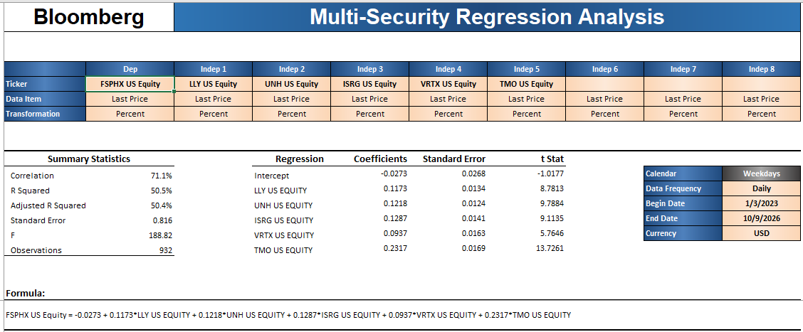

##  OBJETIVO DE LA TAREA
##  1) Comparar las regresiones múltiples de Bloomberg (Multi-Security Regression Analysis) contra mis modelos originales de la Tarea 3.
##  2) Replicar en R las regresiones de Bloomberg con los mismos datos y fechas para cotejar los resultados.
##  3) Contestar las preguntas 16.1 a 16.8 del capítulo 16 de Gujarati (datos de panel).
##  Modelos (Tarea 3): cada mutual fund contra 5 acciones, rendimientos diarios del 3 de enero de 2023 al 9 de octubre de 2026.
##  --Modelo 1: FSELX ~ NVDA + AVGO + AMD + MU + TSM
##  --Modelo 2: FSPHX ~ LLY + UNH + ISRG + VRTX + TMO
##  --Modelo 3: FSUTX ~ DUK + NEE + CEG + VST + NVDA


##  LIBRERIAS RELEVANTES
```{r}
library(MASS)
library(ISLR)
library(quantmod)
library(car)
library(lmtest)
```


##  PRIMERA PARTE: REGRESIONES MÚLTIPLES EN BLOOMBERG

##  Bloomberg, Multi-Security Regression Analysis. Configuración: Last Price, transformación Percent (rendimiento diario en %), frecuencia diaria, del 1/3/2023 al 10/9/2026.





##  COMPARACIÓN CONTRA MIS MODELOS ORIGINALES (TAREA 3)
##  Diferencia clave en los datos: en la Tarea 3 usé el precio de cierre AJUSTADO (corrige los repartos de ganancias de los fondos); Bloomberg usa Last Price, que NO está ajustado.
##  Bloomberg reporta el intercepto y el error estándar en %; en la Tarea 3 estaban en decimales (por ejemplo, -0.00057 = -0.057%).

##  MODELO 1: FSELX
##  | Concepto     | Tarea 3 (ajustado) | Bloomberg (Last Price) |
##  | Intercepto   | -0.057%            | -0.085%                |
##  | NVDA         | 0.266              | 0.265                  |
##  | AVGO         | 0.191              | 0.183                  |
##  | AMD          | 0.124              | 0.118                  |
##  | MU           | 0.161              | 0.159                  |
##  | TSM          | 0.176              | 0.183                  |
##  | R2           | 0.905              | 0.874                  |
##  | Error est.   | 0.75%              | 0.87%                  |
##  | F            | 1,784              | 1,290                  |
##  | Observaciones| 946                | 936                    |
##  Los coeficientes de las acciones son prácticamente iguales (diferencias menores a 0.01) y todos significativos en ambos casos. NVDA sigue siendo la mayor exposición.
##  La R2 baja de 90% a 87% y el error sube en Bloomberg porque, sin ajustar, los días en que el fondo reparte ganancias aparecen como caídas que sus acciones no explican.
##  El intercepto es más negativo en Bloomberg por la misma razón: esos repartos se ven como pérdidas del fondo.

##  MODELO 2: FSPHX
##  | Concepto     | Tarea 3 (ajustado) | Bloomberg (Last Price) |
##  | Intercepto   | +0.005% (no sig.)  | -0.027% (no sig.)      |
##  | LLY          | 0.116              | 0.117                  |
##  | UNH          | 0.125              | 0.122                  |
##  | ISRG         | 0.125              | 0.129                  |
##  | VRTX         | 0.088              | 0.094                  |
##  | TMO          | 0.233              | 0.232                  |
##  | R2           | 0.620              | 0.505                  |
##  | Error est.   | 0.63%              | 0.82%                  |
##  | F            | 306.7              | 188.8                  |
##  | Observaciones| 946                | 932                    |
##  Otra vez los coeficientes son casi idénticos y TMO sigue siendo la mayor exposición. El intercepto no es significativo en ninguno de los dos.
##  Es el modelo con mayor diferencia en R2 (62% vs 50.5%): FSPHX tuvo el reparto más grande (el residual de -11.6% que detecté en la Tarea 2), y con el precio sin ajustar ese día pesa mucho en el error.

##  MODELO 3: FSUTX
##  | Concepto     | Tarea 3 (ajustado) | Bloomberg (Last Price) |
##  | Intercepto   | -0.021% (p=0.097)  | -0.029% (t=-2.09)      |
##  | DUK          | 0.449              | 0.450                  |
##  | NEE          | 0.238              | 0.242                  |
##  | CEG          | 0.083              | 0.087                  |
##  | VST          | 0.097              | 0.093                  |
##  | NVDA         | 0.0045 (no sig.)   | 0.0055 (t=1.06, no sig.)|
##  | R2           | 0.871              | 0.848                  |
##  | Error est.   | 0.38%              | 0.42%                  |
##  | F            | 1,266              | 1,034                  |
##  | Observaciones| 946                | 931                    |
##  Coeficientes casi iguales. NVDA sigue sin ser significativa en Bloomberg (t = 1.06 < 1.96), lo que confirma la conclusión de la Tarea 3: no aporta al modelo de utilities.
##  El intercepto cambia de conclusión: con precio ajustado no es significativo al 5% (p = 0.097), pero con Last Price sí lo es (t = -2.09). Esto muestra que la forma de medir el precio puede cambiar una conclusión, sobre todo en un fondo que reparte ganancias.

##  CONCLUSIÓN DE LA COMPARACIÓN
##  --Las exposiciones a cada acción (coeficientes) son prácticamente las mismas en Bloomberg y en mis modelos: la estructura de los 3 modelos es robusta.
##  --Las diferencias están en la R2, el error estándar y el intercepto, y vienen de usar el precio sin ajustar: los repartos de ganancias de los mutual funds se ven como caídas.
##  --Para fondos que reparten ganancias, el precio ajustado (o rendimiento total) es la medida correcta; si se usa Last Price, hay que tener en cuenta estos días atípicos.
##  --Bloomberg tiene entre 9 y 14 observaciones menos que R (945); la diferencia viene de cómo cada fuente maneja días festivos y fechas sin precio de los fondos, y es muy pequeña frente a ~940 datos.


##  SEGUNDA PARTE: RÉPLICA EN R CON LOS MISMOS DATOS QUE BLOOMBERG (LAST PRICE, EN %)

```{r}

##  Mismos datos que Bloomberg: precio de cierre SIN ajustar, rendimiento diario en % y mismas fechas
rend_cierre <- function(ticker) {
  p <- getSymbols(ticker, from = "2023-01-03", to = "2026-10-10", auto.assign = FALSE)
  r <- dailyReturn(Cl(p)) * 100
  colnames(r) <- ticker
  r
}

datos1 <- as.data.frame(coredata(na.omit(merge(rend_cierre("FSELX"), rend_cierre("NVDA"), rend_cierre("AVGO"),
                                               rend_cierre("AMD"), rend_cierre("MU"), rend_cierre("TSM")))))[-1, ]
datos2 <- as.data.frame(coredata(na.omit(merge(rend_cierre("FSPHX"), rend_cierre("LLY"), rend_cierre("UNH"),
                                               rend_cierre("ISRG"), rend_cierre("VRTX"), rend_cierre("TMO")))))[-1, ]
datos3 <- as.data.frame(coredata(na.omit(merge(rend_cierre("FSUTX"), rend_cierre("DUK"), rend_cierre("NEE"),
                                               rend_cierre("CEG"), rend_cierre("VST"), rend_cierre("NVDA")))))[-1, ]

dim(datos1); dim(datos2); dim(datos3)

```


```{r}

modeloB1 <- lm(FSELX ~ NVDA + AVGO + AMD + MU + TSM, data = datos1)
summary(modeloB1)

##  COTEJO MODELO 1 (R con Last Price vs Bloomberg)
##  | Concepto      | R       | Bloomberg |
##  | Intercepto    | -0.083% | -0.085%   |
##  | NVDA          | 0.265   | 0.265     |
##  | AVGO          | 0.182   | 0.183     |
##  | AMD           | 0.119   | 0.118     |
##  | MU            | 0.160   | 0.159     |
##  | TSM           | 0.179   | 0.183     |
##  | R2            | 0.873   | 0.874     |
##  | Error est.    | 0.873%  | 0.872%    |
##  | F             | 1,287   | 1,290     |
##  | Observaciones | 945     | 936       |
##  Con los mismos datos, R reproduce a Bloomberg: los coeficientes difieren en 0.004 o menos, la R2 es prácticamente igual (87.3% vs 87.4%) y el intercepto negativo es significativo en ambos (t = -2.91 en R y -2.96 en Bloomberg).
##  Las pequeñas diferencias vienen de que Bloomberg usa 9 días menos (936 vs 945) por la forma en que maneja los días sin precio del fondo.
##  Comparado con mi modelo original (precio ajustado), la R2 baja de 90% a 87% y el residual mínimo pasa de -3.0% a -7.6%: ese día atípico es el reparto de ganancias de FSELX, que con el precio sin ajustar aparece como caída.

modeloB2 <- lm(FSPHX ~ LLY + UNH + ISRG + VRTX + TMO, data = datos2)
summary(modeloB2)

##  COTEJO MODELO 2 (R con Last Price vs Bloomberg)
##  | Concepto      | R       | Bloomberg |
##  | Intercepto    | -0.026% | -0.027%   |
##  | LLY           | 0.119   | 0.117     |
##  | UNH           | 0.122   | 0.122     |
##  | ISRG          | 0.126   | 0.129     |
##  | VRTX          | 0.094   | 0.094     |
##  | TMO           | 0.235   | 0.232     |
##  | R2            | 0.504   | 0.505     |
##  | Error est.    | 0.811%  | 0.816%    |
##  | F             | 190.9   | 188.8     |
##  | Observaciones | 945     | 932       |
##  R y Bloomberg coinciden: coeficientes con diferencias de 0.003 o menos, la misma R2 (50.4% vs 50.5%) y el intercepto no significativo en los dos.
##  El residual mínimo de -11.6% en R confirma lo que explica la diferencia contra mi modelo original: es el día de reparto de ganancias de FSPHX. Con el precio sin ajustar, la R2 baja de 62% a 50%.

modeloB3 <- lm(FSUTX ~ DUK + NEE + CEG + VST + NVDA, data = datos3)
summary(modeloB3)

##  COTEJO MODELO 3 (R con Last Price vs Bloomberg)
##  | Concepto      | R              | Bloomberg       |
##  | Intercepto    | -0.028% (t=-2.04) | -0.029% (t=-2.09) |
##  | DUK           | 0.448          | 0.450           |
##  | NEE           | 0.242          | 0.242           |
##  | CEG           | 0.084          | 0.087           |
##  | VST           | 0.095          | 0.093           |
##  | NVDA          | 0.005 (t=0.89) | 0.006 (t=1.06)  |
##  | R2            | 0.843          | 0.848           |
##  | Error est.    | 0.427%         | 0.421%          |
##  | F             | 1,004          | 1,034           |
##  | Observaciones | 945            | 931             |
##  R y Bloomberg coinciden: los coeficientes difieren en 0.003 o menos y las conclusiones son las mismas.
##  --NVDA no es significativa en ninguno de los dos (t de 0.89 y 1.06, menores a 1.96).
##  --El intercepto es significativo al 5% en los dos (p = 0.042 en R) cuando se usa Last Price, mientras que con precio ajustado no lo era. La conclusión sobre el intercepto depende del tipo de precio, no de la fuente de datos.

##  CONCLUSIÓN DEL COTEJO
##  --Con los mismos datos (Last Price, mismas fechas), R y Bloomberg dan prácticamente los mismos resultados en los 3 modelos: mismos coeficientes, misma R2 y mismas conclusiones de significancia.
##  --Las diferencias pequeñas (en el tercer decimal) se explican porque Bloomberg usa entre 9 y 14 observaciones menos.
##  --La diferencia importante no es entre R y Bloomberg, sino entre precio ajustado y sin ajustar: para mutual funds que reparten ganancias, el precio ajustado da un modelo más limpio (mayor R2, menor error y sin atípicos falsos).

```


##  TERCERA PARTE: PREGUNTAS 16.1 A 16.8 DEL CAPÍTULO 16 DE GUJARATI (DATOS DE PANEL)


##  PREGUNTA 16.1
##  ¿Cuáles son las características especiales de a) los datos de corte transversal, b) las series de tiempo y c) los datos de panel?

##  a) Corte transversal: se observan muchas unidades (personas, empresas, países) en un mismo momento. El orden de las observaciones no importa y, como las unidades son muy distintas entre sí (por ejemplo, empresas grandes y pequeñas), es común la heterocedasticidad.
##  b) Series de tiempo: se observa una misma unidad a lo largo de varios periodos. El orden sí importa, y los problemas típicos son la autocorrelación (lo de hoy depende de lo de ayer) y la no estacionariedad.
##  c) Datos de panel: se observan las MISMAS unidades a lo largo del tiempo, combinando las dos dimensiones. Tienen más observaciones y más variación, menos colinealidad entre variables y más grados de libertad; permiten controlar las diferencias propias de cada unidad que no se pueden medir y estudiar cómo cambian las unidades en el tiempo. Pueden ser balanceados (todas las unidades tienen el mismo número de periodos) o no balanceados.


##  PREGUNTA 16.2
##  ¿Qué se quiere dar a entender con modelo de efectos fijos (MEF)? Como los datos de panel presentan las dos dimensiones de tiempo y espacio, ¿cómo es que el MEF permite ambas dimensiones?

##  En el MEF cada unidad tiene su propio intercepto, que recoge sus características particulares que no cambian en el tiempo (por ejemplo, el estilo de administración de una empresa). Se llama "fijo" porque ese intercepto varía entre unidades pero no a lo largo del tiempo. Las pendientes son las mismas para todas.
##  Se estima agregando una variable dicótoma por cada unidad (método de mínimos cuadrados con variables dicótomas, MCVD), con cuidado de no caer en la trampa de las dicótomas (usar N - 1 dicótomas si hay intercepto común).
##  Para permitir las dos dimensiones se agregan también variables dicótomas de tiempo (una por periodo, T - 1), que recogen efectos que afectan a todas las unidades en un mismo año (por ejemplo, una recesión). Así el modelo tiene efectos fijos por unidad y por tiempo.


##  PREGUNTA 16.3
##  ¿Qué se quiere dar a entender con modelo con componentes del error (MCE)? ¿En qué difiere del MEF? ¿Cuándo resulta apropiado el MCE, y cuándo el MEF?

##  En el MCE (efectos aleatorios), en lugar de estimar un intercepto para cada unidad, se supone que el intercepto de cada una es una extracción aleatoria alrededor de un intercepto promedio común: B1i = B1 + e_i. La diferencia propia de cada unidad (e_i) pasa a formar parte del término de error, que queda compuesto: w_it = e_i + u_it.
##  Diferencia con el MEF: el MEF estima las diferencias entre unidades como parámetros (un intercepto por unidad, lo que consume grados de libertad); el MCE las trata como parte del error aleatorio, así que estima menos parámetros y permite incluir variables que no cambian en el tiempo (como el sexo o la región).
##  El supuesto clave del MCE es que e_i NO está correlacionado con las variables explicativas.
##  --MEF es apropiado si e_i sí está correlacionado con las X (el MCE daría estimadores sesgados), o si las unidades no son una muestra aleatoria (por ejemplo, las 10 empresas que nos interesan).
##  --MCE es apropiado si e_i no está correlacionado con las X y las unidades son una muestra aleatoria de una población grande; en ese caso es más eficiente.
##  --Si T es grande y N pequeño, los dos dan resultados parecidos y se suele preferir el MEF. Para decidir formalmente se usa la prueba de Hausman.


##  PREGUNTA 16.4
##  ¿Hay diferencia entre los modelos de mínimos cuadrados con variables dicótomas (MCVD), estimados dentro de grupos y primeras diferencias?

##  Los tres eliminan el efecto propio de cada unidad que no cambia en el tiempo, pero de forma distinta:
##  --MCVD: agrega una variable dicótoma por unidad.
##  --Dentro de grupos (within): a cada variable le resta su promedio por unidad, con lo que el efecto fijo desaparece. Da EXACTAMENTE las mismas pendientes que el MCVD (son dos formas de calcular el mismo modelo), aunque no estima directamente los interceptos de cada unidad.
##  --Primeras diferencias: a cada variable le resta su valor del periodo anterior, lo que también elimina el efecto fijo. En general da pendientes DISTINTAS a las de MCVD y dentro de grupos; solo coinciden cuando hay 2 periodos (T = 2).
##  Cuál conviene depende del error: dentro de grupos es mejor si los errores no están autocorrelacionados, y primeras diferencias si los errores se parecen mucho de un periodo a otro (alta autocorrelación).


##  PREGUNTA 16.5
##  ¿Cuándo resultan inapropiados los modelos de regresión con datos de panel? Proporcione ejemplos.

##  Los modelos de panel (MCO agrupado, MEF y MCE) suponen que todas las unidades comparten las mismas pendientes y que solo difieren en el intercepto. No son apropiados cuando:
##  --Las unidades son tan distintas que las pendientes cambian de una a otra. Ejemplo: juntar en un mismo panel un banco, una empresa de tecnología y una utility para explicar su rendimiento con las mismas variables; cada una responde de forma distinta a las tasas de interés.
##  --Las variables que interesan no cambian en el tiempo y se quiere usar MEF. Ejemplo: medir el efecto del país de origen de una empresa; el MEF lo absorbe en el intercepto y no lo puede estimar.
##  --Hay muy poca variación en el tiempo o T es muy pequeño, de modo que casi no hay información "dentro" de cada unidad. Ejemplo: un panel de empresas con solo 2 años de datos y variables que casi no cambian entre esos años.
##  --El modelo debería ser dinámico (la variable dependiente depende de su valor pasado) o los errores están correlacionados entre unidades. Ejemplo: rendimientos de bancos de un mismo país, que reaccionan juntos a la misma noticia; los errores de una unidad no son independientes de los de las otras.
##  --Hay mucha pérdida de unidades a lo largo del tiempo (desgaste del panel) que no es aleatoria. Ejemplo: un panel de empresas donde solo sobreviven las más exitosas; los resultados quedan sesgados.


##  PREGUNTA 16.6
##  ¿Cómo ampliaría el modelo (16.4.2) para incluir un componente del error en el tiempo? Escriba el modelo explícitamente.

##  El modelo (16.4.2) es la función de costo de 6 aerolíneas con efectos fijos por aerolínea (variables dicótomas D2 a D6):
##  C_it = a1 + a2*D2i + a3*D3i + a4*D4i + a5*D5i + a6*D6i + B2*Q_it + B3*PF_it + B4*LF_it + u_it
##  Para incluir un componente del error en el tiempo se agrega un término lambda_t, que recoge los efectos que afectan a todas las aerolíneas en el mismo año (por ejemplo, el precio del petróleo o una recesión) y que se trata como aleatorio:
##  C_it = a1 + a2*D2i + a3*D3i + a4*D4i + a5*D5i + a6*D6i + B2*Q_it + B3*PF_it + B4*LF_it + lambda_t + u_it
##  donde lambda_t tiene media 0 y varianza sigma^2_lambda, y no está correlacionado con u_it ni con las X.
##  Si también el efecto de cada aerolínea se trata como aleatorio, el error queda con tres componentes: w_it = e_i + lambda_t + u_it (modelo de componentes del error de dos vías):
##  C_it = B1 + B2*Q_it + B3*PF_it + B4*LF_it + e_i + lambda_t + u_it


##  PREGUNTA 16.7
##  Consulte el ejemplo de los huevos y sus precios de la tabla 1.1. ¿Qué modelo resultaría apropiado en este caso, el MEF o el MCE? ¿Por qué?

##  La tabla 1.1 tiene la producción y el precio del huevo de los 50 estados de Estados Unidos en dos años (1990 y 1991): N = 50 y T = 2.
##  Resulta más apropiado el MEF:
##  --Los 50 estados no son una muestra aleatoria de una población más grande: son TODA la población. El MCE supone que las unidades se extraen al azar de un universo mayor, lo que no se cumple aquí.
##  --Cada estado tiene características propias que no cambian entre un año y otro (clima, costos de alimento, tamaño de la industria avícola), y es probable que estén correlacionadas con el precio. Si es así, el MCE daría estimadores sesgados.
##  --Con N grande y T pequeño, Gujarati señala que la elección importa, y cuando las unidades no son una muestra aleatoria se prefiere el MEF.
##  Limitación: con solo 2 años, cada estado aporta muy poca información "dentro" de sí mismo y el MEF consume 49 grados de libertad en dicótomas.


##  PREGUNTA 16.8
##  Para los datos de inversión presentados en la tabla 1.2, ¿qué modelo debe elegirse, MEF o MEFA? ¿Por qué?

##  La tabla 1.2 tiene la inversión de 4 empresas (GE, US Steel, GM y Westinghouse) de 1935 a 1954: N = 4 y T = 20.
##  Debe elegirse el MEF:
##  --Las 4 empresas fueron escogidas específicamente, no extraídas al azar de una población grande de empresas; el interés está en estas empresas en particular.
##  --Con N pequeño y T grande, Gujarati indica que el MEF y el MEFA dan resultados parecidos, y en ese caso se prefiere el MEF por ser más sencillo y no depender del supuesto de que el efecto de cada empresa no esté correlacionado con las variables explicativas.
##  --Es muy probable que las características propias de cada empresa (tamaño, administración, sector) sí estén correlacionadas con su valor de mercado (F) y su capital (C), lo que haría sesgado al MEFA.
##  Además, con solo 4 empresas el MEF solo agrega 3 dicótomas, así que la pérdida de grados de libertad es mínima. La decisión se puede confirmar formalmente con la prueba de Hausman.
